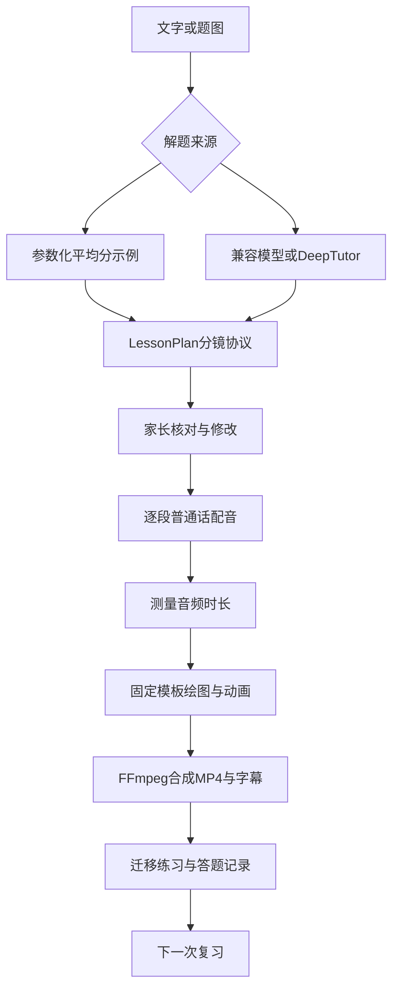

# 从题目到视频：接口和边界

## 当前链路

## 设计选择

1. **结构化分镜是中间协议。** 题意、板书、口播、动画参数同属一个JSON对象。更换解题模型不需要重写渲染器。
2. **音频先生成。** 每段口播生成后用ffprobe测量时长，画面按这个时长输出。避免动画播完而声音还没讲完。
3. **数学画面使用确定模板。** 第一版用Pillow绘制图形，FFmpeg合成视频。平均分按轮次给每组增加一个物品，数量由参数决定。通用讲解只能使用板书模板，不能假装已有任意题型动画。
4. **先做小而完整的本地闭环。** FastAPI+SQLite+单渲染工作线程，无GPU要求。尚不引入云账号、Redis与对象存储。你熟悉Java，后续可以用Spring Boot接管业务层，同时保留Python视频服务。
5. **独立于DeepTutor内部数据库。** 通过已公开CLI调用解题能力，不直接读取或修改它的记忆文件。外部项目更新时，只替换适配器。

## LessonPlan主要字段

| 字段 | 含义 | 约束 |
|---|---|---|
| question / answer | 完整题目、最终答案 | 先让家长核对 |
| knowledge | 单个知识点标签 | 用于复习归类 |
| scenes[].narration | 口播 | 每段最多110字 |
| scenes[].board | 板书 | 最多3行，每行最多36字 |
| scenes[].visual | 动画类型及参数 | board，或整除groups模板 |
| quiz | 迁移题、唯一答案、提示 | 第一版使用简短答案匹配 |

结构校验能防止超大画面和无效分组，不能验证任意文字推导。后续增加“独立解题结果比较+精确数值/单位校验”后，也应保留低置信度回退。

## 任务状态

`draft → queued → rendering → ready`；失败为`failed`，可修改分镜后重试。仅draft/failed可提交生成，避免重复任务。重启后未完成任务标记失败，页面允许重试；当前不支持从某一帧断点续渲染。

同时最多4个已接收任务，单工作线程逐个渲染。模型生成讲解稿目前走同步请求，当前没有完整的模型任务队列或取消接口。公网版必须增加用户限流、持久队列与超时监控。

## 主要API

| 方法 | 路径 | 作用 |
|---|---|---|
| POST | /api/lessons | 从示例、模型或DeepTutor建立讲解稿 |
| GET | /api/lessons?learner=sister | 获取当前孩子的题目 |
| GET | /api/lessons/{id}?learner=sister | 讲解稿、任务状态 |
| POST | /api/lessons/{id}/render | 确认分镜并提交视频任务 |
| GET | /api/lessons/{id}/files/{name}?learner=sister | 视频、SRT与分镜下载 |
| POST | /api/lessons/{id}/answer | 提交练习答案 |
| GET | /api/memory?learner=sister | 答题原始记录、复习摘要与计数 |
| DELETE | /api/lessons/{id}?learner=sister | 删除一题及关联记录 |

## 后续扩展接口

- `ProblemExtractor`：题图OCR、坐标和公式，支持用户逐项修正后再解题。
- `SolutionVerifier`：四则运算、分数、单位换算分别用精确规则校验；推理题用独立求解器交叉检查。
- `TeachingPlanner`：根据年级、知识点、易错原因选择提示方式。
- `VisualTemplate`：数轴、条形图、竖式、面积切分等参数化模板。
- `SpeechProvider`：现有Edge/Mac/兼容接口；以后接其他TTS时保持每段音频+时长返回格式。
- `Renderer`：复杂讲解可扩展Manim或HyperFrames后端，仍消费同一个分镜协议。第一版没有依赖这两个引擎。
- `LearningStore`：错题标签、真实答题证据、不同题目的间隔测验；之后与DeepTutor记忆通过明确接口同步。

## 商业部署演进

家庭验证后：Web/手机网页 → Spring Boot业务API → PostgreSQL + Redis任务队列 → 独立Python渲染Worker → S3兼容对象存储。需要实现登录、每户权限、上传限制、文件到期清理、按任务成本记录，再开放多人使用。

前端可以部署到静态托管服务；Python、FFmpeg和长时视频任务应运行在独立容器服务，不能只把HTML放上线就认为后端也可用。
